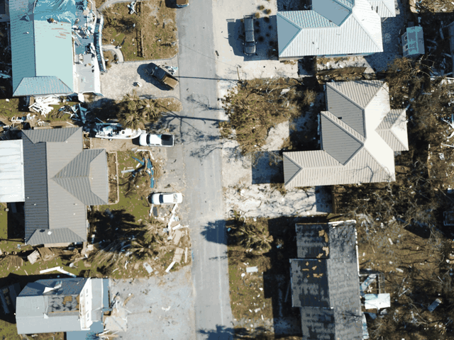
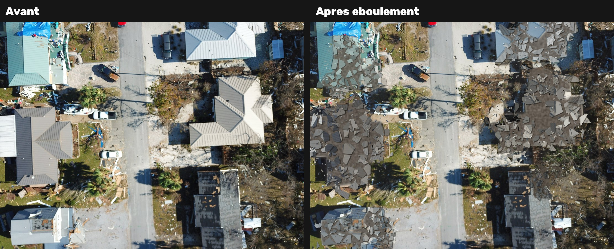
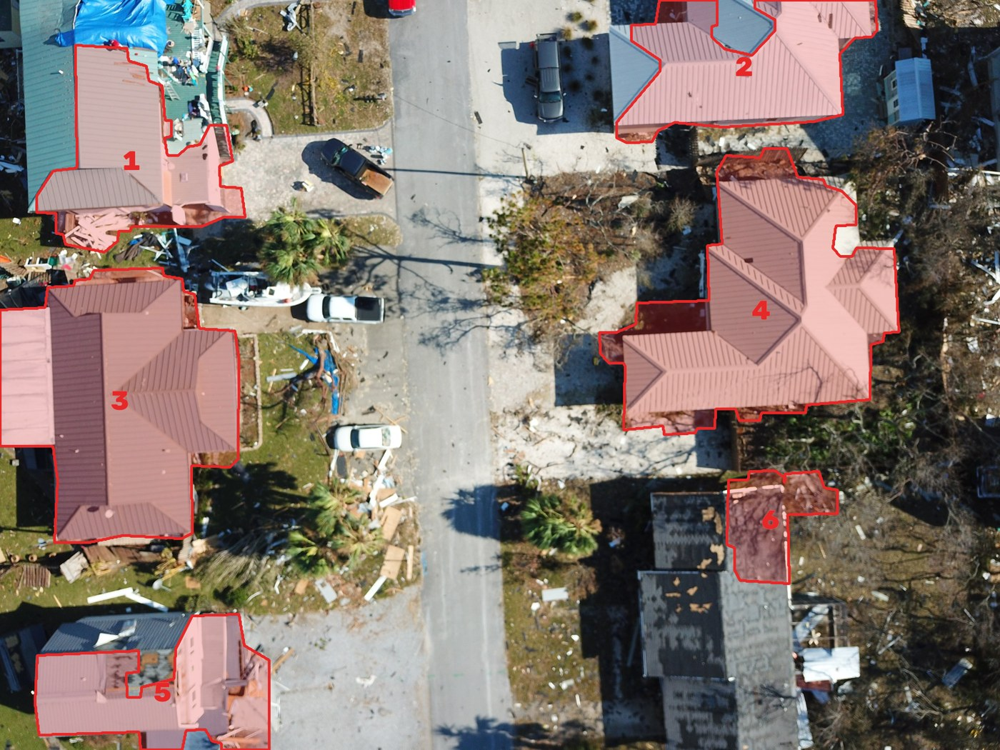

# 🏚️ Ébouler — simulation d'effondrement de bâtiments sur images drone

Détecte automatiquement les bâtiments sur une image aérienne (jeu de données **RescueNet**, ouragan Michael) puis simule leur **éboulement** : le toit se brise en morceaux, s'affaisse, glisse, et un nuage de poussière se lève.

<p align="center">
  
</p>



---

## ✨ Fonctionnalités

- **Détection des bâtiments sans apprentissage** : uniquement du traitement d'image classique, aucun modèle à télécharger.
- **Effondrement réaliste** : fragmentation de Voronoï, chute avec rebond, ombres portées, gravats, débris et poussière.
- **Quatre sorties** : image de détection numérotée, image finale, comparaison avant/après et GIF animé.
- **Paramétrable** : intensité, graine aléatoire, choix des bâtiments, ajout manuel d'un bâtiment raté.

## 📦 Installation

```bash
git clone https://github.com/seydi-alioune-gueye/ebouler-rescuenet.git
cd ebouler-rescuenet
pip install -r requirements.txt
```

Python 3.9 ou plus récent.

## 🚀 Utilisation

```bash
python ebouler.py exemples/14541.jpg
```

Les résultats sont écrits dans `resultats/` :

| Fichier | Contenu |
|---|---|
| `detection.png` | bâtiments détectés, entourés et numérotés |
| `eboulement.png` | image finale en pleine résolution |
| `avant_apres.png` | comparaison côte à côte |
| `animation.gif` | effondrement animé |

### Options

| Option | Rôle | Exemple |
|---|---|---|
| `--sortie` | dossier de sortie | `--sortie mes_resultats` |
| `--intensite` | force de l'effondrement (0.5 léger, 1.5 violent) | `--intensite 1.5` |
| `--graine` | change le tirage aléatoire | `--graine 7` |
| `--seulement` | n'effondre que certains bâtiments (numéros de `detection.png`) | `--seulement 2,4` |
| `--ajout` | ajoute un bâtiment raté, rectangle `x0,y0,x1,y1` en pixels (répétable) | `--ajout 1650,1265,2060,1932` |
| `--images-gif` | nombre d'images de l'animation | `--images-gif 40` |

Exemple complet :

```bash
python ebouler.py exemples/14541.jpg --intensite 1.3 --ajout 1650,1265,2060,1932
```

## 🔍 Détection des bâtiments

<p align="center">
  
</p>

1. **Superpixels SLIC** : l'image est découpée en environ 1 500 zones homogènes.
2. **Mesures par zone** :
   - saturation et luminosité (espace HSV) ;
   - texture locale (écart-type) ;
   - **cohérence d'orientation** du tenseur de structure, élevée sur les nervures parallèles des toits en tôle.
3. **Exclusion de la route** : grande zone grise, lisse et étendue.
4. **Deux familles de toits** :
   - toits en tôle : peu saturés, très orientés ;
   - toits en bardeaux : gris, plus sombres, texturés.
5. **Nettoyage et filtrage par forme** :
   - morphologie mathématique ;
   - extraction des contours, simplifiés par Douglas–Peucker ;
   - surface minimale, solidité et rectangularité.

## 💥 Simulation de l'éboulement

1. L'emprise du bâtiment est remplacée par un **sol de gravats**, teinté avec la couleur du toit.
2. Le toit est découpé en **25 à 90 fragments de Voronoï**.
3. Chaque fragment subit une **transformation affine** : rotation, réduction (il tombe) et translation vers l'extérieur. Environ 65 % des fragments restent sur place, ce qui donne un effondrement « en crêpe ».
4. Le mouvement suit une **courbe « bounce »**, pour un impact avec rebond.
5. **Ombres portées, débris projetés et nuage de poussière** sont ajoutés par composition alpha. La poussière monte puis retombe.
6. Les bâtiments ne tombent pas tous en même temps : chacun a un léger délai aléatoire.

## ⚠️ Limites

- Les seuils ont été réglés sur un petit nombre d'images RescueNet. Ils peuvent demander un ajustement sur d'autres scènes.
- Les toits très sombres, à l'ombre ou couverts de bâches peuvent être détectés partiellement. Dans ce cas, utilise `--ajout`.
- Pour une détection robuste, on pourrait entraîner un réseau de segmentation (U-Net, DeepLabv3+) sur les masques de RescueNet. Voir les pistes d'amélioration ci-dessous.

## 🛣️ Pistes d'amélioration

- [ ] Utiliser les masques de segmentation officiels de RescueNet à la place de la détection heuristique.
- [ ] Entraîner un modèle U-Net pour la détection.
- [ ] Ajouter un mode « niveau de dégâts » : effondrement partiel ou total selon la classe RescueNet.
- [ ] Exporter l'animation en MP4.

## 📚 Références

**Données**
- M. Rahnemoonfar, T. Chowdhury, R. Murphy, *RescueNet: A High Resolution UAV Semantic Segmentation Dataset for Natural Disaster Damage Assessment*, Scientific Data 10, 913 (2023). https://doi.org/10.1038/s41597-023-02799-4

**Méthodes**
- R. Achanta et al., *SLIC Superpixels Compared to State-of-the-Art Superpixel Methods*, IEEE TPAMI, 2012.
- J. Bigün, G. Granlund, *Optimal Orientation Detection of Linear Symmetry*, ICCV, 1987 (tenseur de structure).
- J. Serra, *Image Analysis and Mathematical Morphology*, Academic Press, 1982.
- S. Suzuki, K. Abe, *Topological Structural Analysis of Digitized Binary Images by Border Following*, 1985.
- D. Douglas, T. Peucker, *Algorithms for the Reduction of the Number of Points Required to Represent a Digitized Line*, 1973.
- J. L. Bentley, *Multidimensional Binary Search Trees Used for Associative Searching*, 1975 (arbre k-d).
- T. Porter, T. Duff, *Compositing Digital Images*, SIGGRAPH, 1984.
- R. Penner, *Robert Penner's Programming Macromedia Flash MX*, 2002 (fonctions d'interpolation « easing »).

**Bibliothèques** : OpenCV, scikit-image, SciPy, NumPy, imageio.

## 📝 Licence

- **Code** : sous licence MIT, voir [LICENSE](LICENSE).
- **Image d'exemple** (`exemples/14541.jpg`) : elle provient de RescueNet et reste soumise à la licence de ce jeu de données. Merci de citer l'article ci-dessus si tu utilises ces données.
